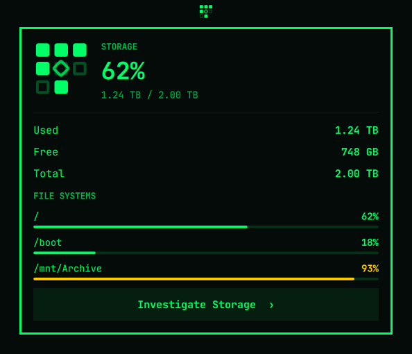
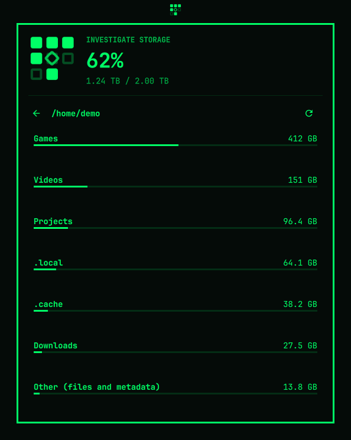
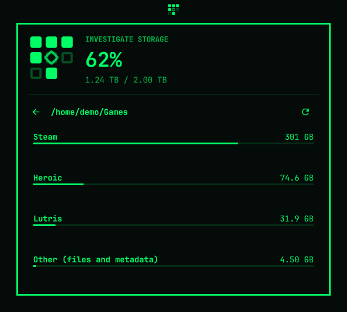
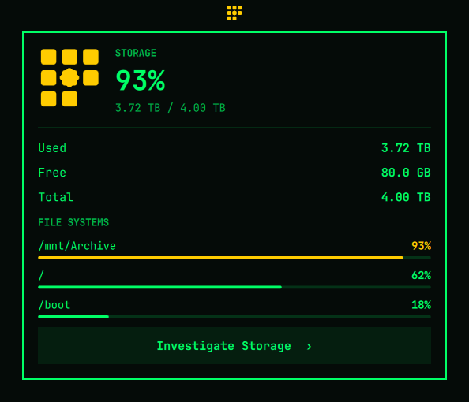

# Omarchy Storage

**A storage meter for the Omarchy bar. The glyph is the gauge.**
Click it for used, free and total space; ask for more and it measures your folders one
level at a time.

<p align="center">
  <a href="docs/media/glance.png"></a>
  <br><sub>The real widget running in Quickshell on Hyprland, with a demo theme and synthetic disk data (see <a href="#about-the-screenshots">About the screenshots</a>).</sub>
</p>

Omarchy Storage is a native bar widget for the [Omarchy](https://omarchy.org) shell. It is a
handful of QML files and one tiny shell script. It runs no daemon, keeps no index and makes no
network connections.

## What it shows

| Investigate a folder | Drill into a child | Warning from 90% |
| :---: | :---: | :---: |
| <a href="docs/media/investigate.png"></a> | <a href="docs/media/drilldown.png"></a> | <a href="docs/media/warning.png"></a> |
| *Investigate Storage* measures the immediate sub-folders of your home folder. | Click a row to measure exactly that folder next. The arrow goes back up. | From 90% the glyph and the mount row use the theme's urgent colour. |

**In the bar:** an eight-segment glyph. Each lit segment stands for one eighth of the
configured mount's usage, rounded up. Once all eight are lit (above 87.5%), the centre
diamond fills too. From 90% the glyph switches to the theme's urgent colour. The tooltip
shows the exact percentage.

**Glance panel** (left click), for the configured mount (default `/`):

- usage in percent, and used / total;
- **Used**, **Free** (space your user can still write) and **Total**;
- **File systems**: every real mounted file system (`findmnt --real`, so no `tmpfs`, `proc`
  and the like) with its usage. Btrfs subvolumes of the same pool are shown once.

**Investigation** (*Investigate Storage*):

- the size of each immediate sub-folder of the start folder (default: your home), largest
  first, with a bar relative to the folder total;
- *Other (files and metadata)*: files directly in the folder, plus anything not attributed to
  a sub-folder;
- click a sub-folder to measure it, use the arrow to go up, and the round arrow to scan again
  or to cancel a running scan.

Nothing is measured until you ask. Closing the panel or picking another folder stops the
running scan.

## Requirements

- **Omarchy 4.5 or newer** with its Quickshell-based shell (bar widgets via `omarchy plugin`).
- `findmnt` from util-linux, GNU `du` from coreutils and `bash`. All three are part of every
  Omarchy/Arch install.

**Tested for v0.1.0:** Omarchy 4.5.0 on x86_64 with Hyprland, Quickshell 0.3.2, Qt 6.12.0,
util-linux 2.42.4 and coreutils 9.12, on a horizontal top bar at fractional scaling 1.25.
Vertical bars, multi-monitor setups and other Omarchy versions have **not** been tested.
See [docs/QA.md](docs/QA.md).

## Install

```sh
omarchy plugin add https://github.com/JK3RN/omarchy-storage --enable
```

Omarchy shows its usual warning for third-party plugins, clones the repository to
`~/.config/omarchy/plugins/dev.kern.storage`, validates the manifest and asks where to
put the widget (default: right). To move it later:

```sh
omarchy bar move dev.kern.storage --section right   # left, centerBegin, center, centerEnd, right
```

**Manual install.** Copy or clone the repository to exactly
`~/.config/omarchy/plugins/dev.kern.storage`. The folder name must match the plugin id,
because the panel starts `scripts/storage-scan` from there. Keep the executable bit of
`scripts/storage-scan`, then run `omarchy plugin enable dev.kern.storage`.

## Uninstall

```sh
omarchy plugin remove dev.kern.storage
```

This unloads the widget from the running shell and deletes the plugin folder. The plugin
writes no other files, so nothing else is left behind.

## Use

| Action | Effect |
| --- | --- |
| Left click on the glyph | Open or close the glance panel |
| Middle click on the glyph | Re-read file system usage now |
| *Investigate Storage* | Measure the start folder |
| Click a folder row | Measure that folder |
| ← button | Go up one level (from the start folder: back to the glance view) |
| `Esc` | Close the panel |

The shell IPC target `dev.kern.storage` offers `open`, `close`, `toggle` and `refresh`, for
example for a key binding:

```sh
omarchy-shell dev.kern.storage toggle
```

## Configuration

Three settings, stored in the widget's entry in `~/.config/omarchy/shell.json`:

| Key | Default | Meaning |
| --- | --- | --- |
| `mount` | `/` | Mount point that drives the glyph and the Used/Free/Total block. |
| `refreshSeconds` | `60` | Seconds between usage refreshes. Values below 15 are raised to 15. |
| `investigatePath` | `~` | Start folder for *Investigate Storage*. `~` and `~/…` are expanded. |

```sh
omarchy bar set dev.kern.storage mount /mnt/Archive
omarchy bar set dev.kern.storage refreshSeconds 120 --json
omarchy bar set dev.kern.storage investigatePath "~/Games"
```

If the configured mount is not present (an unplugged drive, for example), the glyph follows
the first listed file system instead, usually `/`.

## How it stays light

| When | What runs | Cost |
| --- | --- | --- |
| Every `refreshSeconds`, and when the panel opens | `findmnt --json --list --bytes --real --output TARGET,SOURCE,FSTYPE,SIZE,USED,AVAIL` | File system metadata only, no directory walk |
| *Investigate Storage* or a row click | `scripts/storage-scan <folder>`, which runs `du -x -B1 --max-depth=1 -- <folder>` | Reads one folder tree and **stays on its file system** (`-x`) |

A timer never starts a directory scan. At most one scan runs at a time, and it is stopped
when you close the panel, cancel it or pick another folder. Results live only in memory.

## Privacy and security

- **No network, no root, no daemon, no telemetry.** The plugin writes no files. Its only
  settings are the three keys above, kept in Omarchy's own configuration.
- **Commands run without a shell.** Folder paths are passed as single arguments, and `--`
  stops them from being read as options. Names with spaces, leading dashes or Unicode are
  handled; `tests/storage-scan.test.sh` checks this.
- **No elevation.** `du` skips folders you cannot read. The panel then shows the partial
  result together with `du`'s permission message.
- **What appears on screen.** The panel shows mount points and folder names, such as your
  home path. Keep this in mind when you share your screen. Device paths are read from
  `findmnt` (to merge Btrfs subvolumes) but never displayed. UUIDs are not read.
- Like every Omarchy plugin, this code runs inside your shell process with your user's
  rights. Review it before installing; the plugin itself is about 700 lines.

## Known limits

- **Used + Free can be less than Total.** *Free* is what your user can still write, and file
  systems such as ext4 keep reserved blocks.
- **`du` totals and file system usage differ** with sparse files, compression, reflinks,
  snapshots and hard links. The investigation shows `du`'s view.
- **Btrfs**: subvolumes are merged only when they report identical pool numbers.
- **Folder names containing a newline** cannot be shown, because `du` output is read line by
  line.
- **Very large trees** take as long as `du` needs. The scan can be cancelled at any time.
- **If `findmnt` cannot be started at all**, the glyph stays empty and the panel keeps
  waiting for data without an error message. On Omarchy `findmnt` is always installed. A
  `findmnt` that runs but fails is reported in the panel.
- Tested only on a horizontal bar on a single monitor (see *Requirements*).

## Tests

```sh
tests/run-all.sh
```

| Suite | Covers | Needs |
| --- | --- | --- |
| `tests/model.test.js`, `tests/model-edge.test.js` | Parsing of `findmnt` and `du` output, Btrfs merging, malformed data, number formatting, path helpers | Node.js |
| `tests/storage-scan.test.sh` | The scan script with real GNU `du` on a temporary tree: one level only, spaces, leading dashes, Unicode, unreadable folders, missing targets, no writes | bash, coreutils |
| `tests/qml/run.sh` | The real QML in a real Quickshell process with Omarchy's shell modules, with stand-ins for `findmnt` and `du`: refresh, changing and vanishing mounts, failures, glyph thresholds, theme colours, scan, drill-down, back, cancel, switching targets, missing `findmnt` | Omarchy, Quickshell, a Wayland session |

The QML suite reports SKIP when Quickshell, Omarchy's shell modules or a Wayland session are
not available.

## About the screenshots

The images in `docs/media` are real captures of this plugin's QML running in Quickshell with
Omarchy's own UI components on a Hyprland desktop. To keep personal data out of them,
[`tools/showcase/capture.sh`](tools/showcase/capture.sh) runs the shell in a bubblewrap
sandbox with an empty `/home`, a demo user `/home/demo`, and stand-ins for `findmnt` and `du`
that print the synthetic numbers in `tools/showcase/data`. The bar in the images holds only
this widget. The *Phosphor & Sulfur* colours come from a demo Omarchy theme
(`tools/showcase/theme`). The plugin has no colours of its own and follows your active theme.

## License

[MIT](LICENSE). No third-party code is included. At runtime the plugin uses the Quickshell and
Omarchy shell modules installed on your system; they are not part of this repository.
